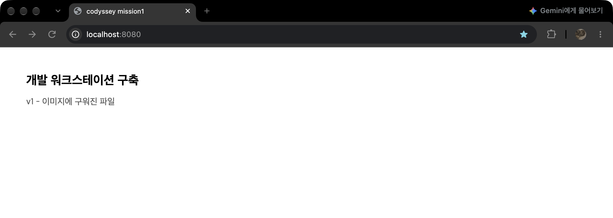
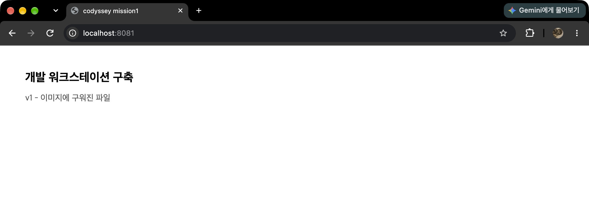
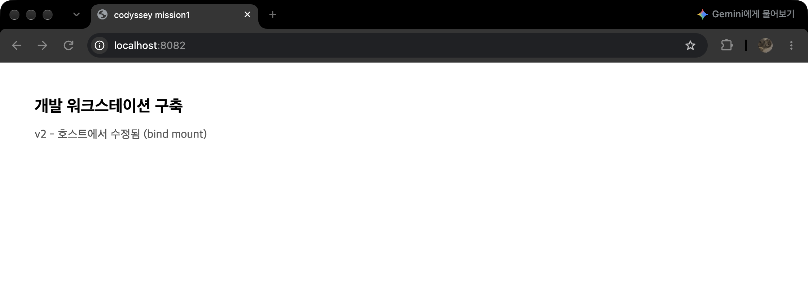
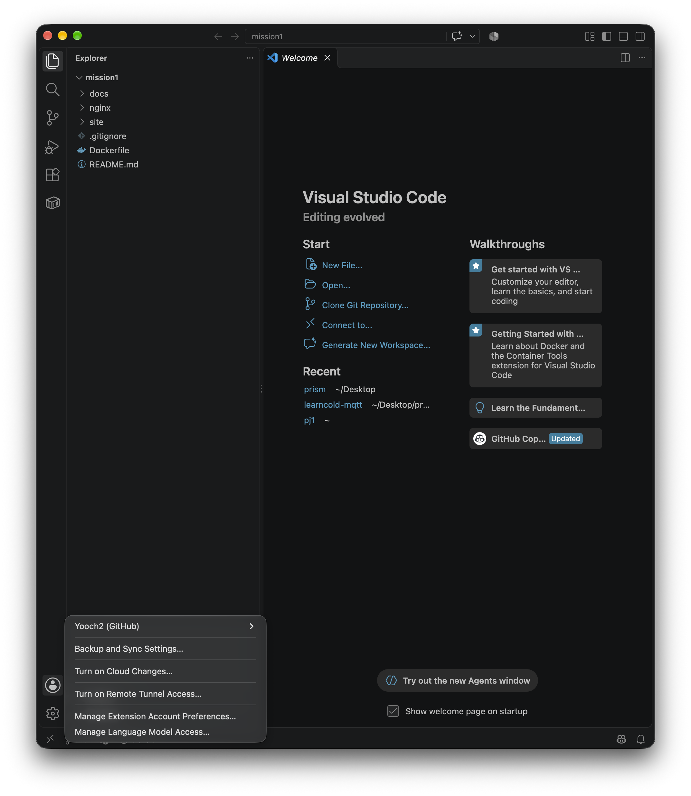
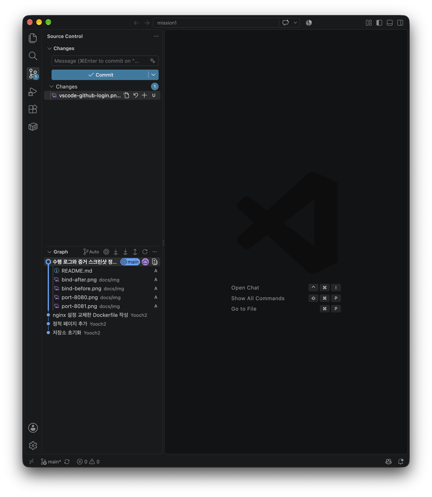

# 미션1 — 개발 워크스테이션 구축

터미널, Docker, Git을 직접 세팅하고 그 과정을 기록한 결과물이다.
웹 서버를 Dockerfile로 컨테이너화한 뒤, 포트 매핑으로 접속을 확인하고
바인드 마운트와 볼륨으로 "변경 반영"과 "데이터 영속성"을 검증했다.

실행한 명령과 출력은 모두 아래에 그대로 옮겼다.

## 1. 실행 환경

```
$ sw_vers
ProductName:		macOS
ProductVersion:		27.0.1
BuildVersion:		26A434

$ echo $SHELL
/bin/zsh

$ docker --version
Docker version 29.7.2, build a7dcaa6

$ git --version
git version 2.54.0 (Apple Git-157)
```

| 항목 | 값 |
|---|---|
| OS | macOS 27.0.1 (빌드 26A434) |
| 쉘 / 터미널 | zsh / macOS 기본 터미널 |
| Docker | 29.7.2 (Docker Desktop, 컨테이너 OSType linux, aarch64) |
| Git | 2.54.0 (Apple Git-157) |

미션 예시 환경은 Ubuntu 22.04 / bash인데 여기서는 macOS / zsh을 썼다.
명령어는 대부분 동일하지만 아래 두 가지가 다르므로 재현 시 참고가 필요하다.

- `sed -i` 사용법이 다르다. macOS는 `sed -i '' 's/.../.../' 파일` 처럼 빈 문자열 인자가 필요하고, GNU sed는 `sed -i 's/.../.../' 파일` 이다.
- Docker Desktop은 리눅스 VM 위에서 동작하므로 `docker info`의 Kernel Version이 호스트 커널이 아니라 linuxkit으로 찍힌다.

## 2. 수행 항목 체크리스트

| 항목 | 검증 방법 | 결과 |
|---|---|---|
| 터미널 기본 조작 | `pwd` `ls -la` `cd` `mkdir` `touch` `cat` `cp` `mv` `rm` | [4. 터미널 조작](#4-터미널-조작) |
| 권한 변경 (파일/디렉터리) | `chmod` 전후 `ls -l` / `ls -ld` 비교, 거부 메시지 확인 | [5. 파일 권한](#5-파일-권한) |
| Docker 설치·점검 | `docker --version` `docker info` | [6. Docker 설치 및 점검](#6-docker-설치-및-점검) |
| Docker 운영 명령 | `docker pull` `images` `ps` `ps -a` `logs` `stats` | [6](#6-docker-설치-및-점검), [9](#9-포트-매핑) |
| 컨테이너 실행 / attach·exec | `docker run` 후 `docker ps` 상태 비교, `docker logs` 대조 | [7. 컨테이너 실행](#7-컨테이너-실행과-attachexec-차이) |
| Dockerfile 커스텀 이미지 | `docker build` → `docker image inspect`로 적용 확인 | [8. 커스텀 이미지](#8-커스텀-이미지-제작) |
| 포트 매핑 | `-p`로 두 포트에 띄우고 `curl` + 브라우저 접속 | [9. 포트 매핑](#9-포트-매핑) |
| 바인드 마운트 | 호스트 파일 수정 후 재빌드 없이 응답 변화 확인 | [10. 바인드 마운트](#10-바인드-마운트) |
| 볼륨 영속성 | 컨테이너 삭제 후 새 컨테이너에서 같은 파일 읽기 | [11. 볼륨 영속성](#11-볼륨-영속성) |
| Git 설정 / GitHub 연동 | `git config --list`, VSCode 연동 화면 | [12. Git과 GitHub](#12-git과-github) |

## 3. 디렉터리 구조

```
mission1/
├── Dockerfile
├── nginx/
│   └── default.conf      베이스 이미지의 기본 설정을 교체
├── site/
│   ├── index.html
│   └── style.css
├── docs/img/             증거 스크린샷
└── README.md
```

실습용 임시 파일은 레포에 넣지 않았다. 터미널·권한 실습은 `~/codyssey/practice`에서 따로 했다.

## 4. 터미널 조작

```
$ cd ~/codyssey/practice
$ pwd
/Users/ych/codyssey/practice

$ ls -la
total 0
drwxr-xr-x  2 ych  staff  64 10월 23 18:21 .
drwxr-xr-x  3 ych  staff  96 10월 23 18:21 ..

$ mkdir -p ~/codyssey/practice/work
$ cd work
$ pwd
/Users/ych/codyssey/practice/work
```

빈 파일 생성과 내용 확인.

```
$ touch empty.txt
$ ls -la
total 0
drwxr-xr-x  3 ych  staff  96 10월 23 18:23 .
drwxr-xr-x  3 ych  staff  96 10월 23 18:22 ..
-rw-r--r--  1 ych  staff   0 10월 23 18:23 empty.txt

$ echo "mission1 memo" > memo.txt
$ cat memo.txt
mission1 memo

$ cat empty.txt
(출력 없음)
```

복사, 이름 변경, 이동, 삭제.

```
$ cp memo.txt memo_backup.txt
$ ls -1
empty.txt
memo_backup.txt
memo.txt

$ mv memo_backup.txt memo_renamed.txt
$ ls -1
empty.txt
memo_renamed.txt
memo.txt

$ mkdir archive
$ mv memo_old.txt archive/
$ ls -1 archive
memo_old.txt

$ rm archive/memo_old.txt
$ rmdir archive
$ ls -1a
.
..
empty.txt
memo_backup.txt
memo.txt
```

`ls -la`로 숨김 파일까지 확인했다. `ls`만 쓰면 `.`으로 시작하는 항목이 보이지 않는다.

### 절대경로와 상대경로

```
$ pwd
/Users/ych/codyssey/practice/work

$ cd /Users/ych/codyssey/practice/work   # 절대경로
$ pwd
/Users/ych/codyssey/practice/work

$ cd ..                                   # 상대경로
$ pwd
/Users/ych/codyssey/practice

$ cd ./work                               # 상대경로
$ pwd
/Users/ych/codyssey/practice/work
```

절대경로는 `/`에서 시작해 전체 경로를 다 쓰므로 현재 위치가 어디든 같은 곳을 가리킨다.
상대경로는 현재 위치를 기준으로 하므로 `cd ..`나 `cd ./work`의 결과가 어디서 쳤는지에 따라 달라진다.
위 출력에서 같은 디렉터리에 세 가지 방식으로 도달한 것을 볼 수 있다.

## 5. 파일 권한

### 파일

```
$ touch report.txt
$ ls -l report.txt
-rw-r--r--  1 ych  staff  0 10월 23 18:30 report.txt

$ chmod 444 report.txt
$ ls -l report.txt
-r--r--r--  1 ych  staff  0 10월 23 18:30 report.txt

$ echo "추가" >> report.txt
zsh: permission denied: report.txt

$ chmod 644 report.txt
$ echo "추가" >> report.txt
$ cat report.txt
추가
```

### 디렉터리

```
$ mkdir -p secret
$ echo "inside" > secret/note.txt
$ ls -ld secret
drwxr-xr-x  3 ych  staff  96 10월 23 18:30 secret

$ chmod 644 secret
$ ls -ld secret
drw-r--r--  3 ych  staff  96 10월 23 18:30 secret

$ cd secret
cd: permission denied: secret

$ cat secret/note.txt
cat: secret/note.txt: Permission denied

$ chmod 755 secret
$ ls -ld secret
drwxr-xr-x  3 ych  staff  96 10월 23 18:30 secret

$ cd secret && pwd && cat note.txt && cd ..
/Users/ych/codyssey/practice/work/secret
inside
```

### 755, 644가 읽히는 방식

세 자리 숫자는 순서대로 소유자, 그룹, 기타 사용자의 권한이다.
각 자리는 읽기 4, 쓰기 2, 실행 1을 더한 값이다.

| 표기 | 계산 | 결과 |
|---|---|---|
| 644 | 6=4+2, 4, 4 | `rw-r--r--` 소유자만 쓰기 가능 |
| 444 | 4, 4, 4 | `r--r--r--` 아무도 못 씀 |
| 755 | 7=4+2+1, 5=4+1, 5=4+1 | `rwxr-xr-x` 소유자는 전부, 나머지는 읽기와 실행 |

파일과 디렉터리에서 x의 의미가 다르다. 파일에서 x는 실행 권한이지만,
디렉터리에서 x는 그 안으로 들어가고 내부 파일에 접근할 수 있는 권한이다.
위에서 `secret`을 755에서 644로 바꾸자 x가 빠지면서 `cd`와 `cat`이 모두 거부된 것이 그 근거다.
디렉터리의 r은 이름 목록을 볼 수 있는 권한이라 x 없이 r만 있으면 이름은 보이지만 열 수는 없다.

## 6. Docker 설치 및 점검

```
$ docker --version
Docker version 29.7.2, build a7dcaa6

$ docker info
Server:
 Containers: 12
  Running: 2
  Paused: 0
  Stopped: 10
 Images: 12
 Server Version: 29.7.2
 Storage Driver: overlay2
  Backing Filesystem: extfs
 Logging Driver: json-file
 Cgroup Driver: cgroupfs
 Cgroup Version: 2
 Swarm: inactive
 Runtimes: runc io.containerd.runc.v2
 Default Runtime: runc
 Kernel Version: 7.0.12-linuxkit
 Operating System: Docker Desktop
 OSType: linux
 Architecture: aarch64
 CPUs: 10
 Total Memory: 7.748GiB
 Docker Root Dir: /var/lib/docker
```

처음 실행했을 때는 Server 절이 실패했다. [트러블슈팅 1](#1-docker-info의-server-절만-실패)에 정리했다.

### 이미지 다운로드

```
$ docker pull nginx:alpine
alpine: Pulling from library/nginx
d3531b7a4f21: Pull complete
1408044c7403: Pull complete
7b9d02243238: Pull complete
f523b340a6c0: Pull complete
dbb1ef19121a: Pull complete
567a969e0221: Pull complete
c2fefbef5314: Pull complete
cbe54b031f3e: Pull complete
Digest: sha256:a3554c0d0b48177b1413c26e01f695334428020d9df01243fbae3e11cfd17417
Status: Downloaded newer image for nginx:alpine
docker.io/library/nginx:alpine

$ docker pull ubuntu:24.04
24.04: Pulling from library/ubuntu
d5aec63251bb: Pull complete
Digest: sha256:68ee22004a9109b44973313b02ff7b1de250f1de0f5ecb628d73f579aaff33ac
Status: Downloaded newer image for ubuntu:24.04
docker.io/library/ubuntu:24.04
```

nginx:alpine은 레이어가 8개, ubuntu:24.04는 1개다.
Digest가 고정값이므로 다른 PC에서도 같은 이미지를 받았는지 확인할 수 있다.

```
$ docker images nginx:alpine
IMAGE          ID             DISK USAGE   CONTENT SIZE   EXTRA
nginx:alpine   ef9a6e2b45c2       62.7MB             0B

$ docker images ubuntu:24.04
IMAGE          ID             DISK USAGE   CONTENT SIZE   EXTRA
ubuntu:24.04   f3ff6f5009cb        101MB             0B    U
```

이 PC에는 다른 프로젝트 이미지도 섞여 있어서 태그로 필터해 출력했다.
Docker 29의 `docker images`는 인자를 하나만 받아서 두 개를 한 번에 넘기면 에러가 난다.
EXTRA 열의 U는 In Use, 즉 그 이미지를 쓰는 컨테이너가 존재한다는 뜻이다.

## 7. 컨테이너 실행과 attach/exec 차이

```
$ docker run hello-world
Unable to find image 'hello-world:latest' locally
latest: Pulling from library/hello-world
58dee6a49ef1: Pull complete
Digest: sha256:11a3eb1597e864c51b3f56733cb2e8a90bf0c284bfc05f9444d81c558bc848aa
Status: Downloaded newer image for hello-world:latest

Hello from Docker!
This message shows that your installation appears to be working correctly.

To generate this message, Docker took the following steps:
 1. The Docker client contacted the Docker daemon.
 2. The Docker daemon pulled the "hello-world" image from the Docker Hub.
    (arm64v8)
 3. The Docker daemon created a new container from that image which runs the
    executable that produces the output you are currently reading.
 4. The Docker daemon streamed that output to the Docker client, which sent it
    to your terminal.
```

### ubuntu 컨테이너 진입

```
$ docker run -it --name ub-once ubuntu:24.04 bash
root@cc8857ba350e:/# ls
bin  boot  dev  etc  home  lib  media  mnt  opt  proc  root  run  sbin  srv  sys  tmp  usr  var

root@cc8857ba350e:/# echo "hello from container"
hello from container

root@cc8857ba350e:/# cat /etc/os-release
PRETTY_NAME="Ubuntu 24.04.5 LTS"
NAME="Ubuntu"
VERSION_ID="24.04"
VERSION="24.04.5 LTS (Noble Numbat)"
VERSION_CODENAME=noble
ID=ubuntu
ID_LIKE=debian

root@cc8857ba350e:/# exit
exit
```

호스트는 macOS에 zsh인데 컨테이너 안은 Ubuntu 24.04에 bash다. 실행 환경이 분리돼 있다는 뜻이다.

```
$ docker ps -a | head -2
CONTAINER ID   IMAGE          COMMAND   CREATED              STATUS                      NAMES
cc8857ba350e   ubuntu:24.04   "bash"    About a minute ago   Exited (0) 15 seconds ago   ub-once
```

### exec로 들어갔다 나온 경우

```
$ docker run -dit --name ub-live ubuntu:24.04 bash
2a2f6b6f06a94ab069d420f184fe90fcb5522878f22d4845d8a99c356d6aaed7

$ docker ps | head -2
CONTAINER ID   IMAGE          COMMAND   CREATED          STATUS         NAMES
2a2f6b6f06a9   ubuntu:24.04   "bash"    10 seconds ago   Up 9 seconds   ub-live

$ docker exec -it ub-live bash
root@2a2f6b6f06a9:/# echo "via exec"
via exec
root@2a2f6b6f06a9:/# exit
exit

$ docker ps | head -2
CONTAINER ID   IMAGE          COMMAND   CREATED          STATUS          NAMES
2a2f6b6f06a9   ubuntu:24.04   "bash"    36 seconds ago   Up 35 seconds   ub-live
```

나왔는데도 ub-live가 Up 상태로 남아 있다.

### attach로 들어갔다 나온 경우

```
$ docker attach ub-live
root@2a2f6b6f06a9:/# echo "via attach"
via attach
root@2a2f6b6f06a9:/# exit
exit

$ docker ps | head -3
CONTAINER ID   IMAGE                               COMMAND                  STATUS          NAMES
77da3eb74bfd   timescale/timescaledb:latest-pg15   "docker-entrypoint.s…"   Up 18 minutes   prizm-local-db-1
1ce543ed92a8   prizm-local-web                     "docker-entrypoint.s…"   Up 18 minutes   prizm-local-web-1

$ docker ps -a | head -3
CONTAINER ID   IMAGE          COMMAND    CREATED         STATUS                         NAMES
b2ab96bd853b   hello-world    "/hello"   3 minutes ago   Exited (0) 3 minutes ago       eager_pike
2a2f6b6f06a9   ubuntu:24.04   "bash"     7 minutes ago   Exited (0) About a minute ago  ub-live
```

이번에는 ub-live가 `docker ps`에서 사라지고 `docker ps -a`에 Exited (0)로 남았다.
삭제된 것은 아니고 멈춘 상태다.

```
$ docker logs ub-live
root@2a2f6b6f06a9:/#
root@2a2f6b6f06a9:/# echo "via attach"
via attach
root@2a2f6b6f06a9:/# exit
exit
```

### 관찰한 것과 해석

관찰한 사실은 세 가지다.

1. exec로 들어간 bash를 exit해도 ub-live는 Up 상태로 유지됐다.
2. attach로 들어간 뒤 exit하자 ub-live가 Exited (0)로 멈췄다.
3. `docker logs ub-live`에는 `via attach`만 있고 `via exec`는 없다.

`docker run -dit ... bash`로 띄우면 컨테이너의 1번 프로세스가 bash다.
attach는 이 1번 프로세스의 입출력에 직접 연결하는 것이라, exit하면 1번 프로세스가 끝난다.
컨테이너는 1번 프로세스가 끝나면 같이 종료되므로 컨테이너도 멈춘다.

exec는 실행 중인 컨테이너 안에 새 프로세스를 하나 더 띄우는 것이다.
그 프로세스를 끝내도 1번 프로세스는 살아 있으므로 컨테이너는 유지된다.

3번이 이 해석을 뒷받침한다. `docker logs`는 1번 프로세스의 출력만 모으는데,
exec로 띄운 bash는 별도 프로세스라서 로그에 남지 않았다.

attach 중에 컨테이너를 종료하지 않고 빠져나오려면 `Ctrl+P` `Ctrl+Q`를 쓰면 된다.

## 8. 커스텀 이미지 제작

미션의 유형 (A) 웹 서버 베이스 이미지 활용 + 정적 콘텐츠·설정 교체를 선택했다.

### 베이스 선택 이유

정적 파일을 서빙하는 것이 목적이라 웹 서버 완제품인 nginx를 베이스로 썼다.
별도 애플리케이션 코드를 작성하지 않아도 되고, alpine 태그는 62.7MB로 가벼워 빌드와 전송이 빠르다.

### Dockerfile

```dockerfile
FROM nginx:alpine

LABEL org.opencontainers.image.title="codyssey-web"
LABEL org.opencontainers.image.description="mission1 static web server"

ENV APP_ENV=dev

COPY nginx/default.conf /etc/nginx/conf.d/default.conf
COPY site/ /usr/share/nginx/html/

EXPOSE 8080
```

### 커스텀 포인트별 목적

| 지시어 | 목적 |
|---|---|
| `FROM nginx:alpine` | 웹 서버 완제품을 베이스로 사용. alpine 변형이 62.7MB로 가볍다 |
| `LABEL` 2개 | 이미지에 용도 메타데이터를 넣어 `docker inspect`로 출처를 식별할 수 있게 함 |
| `ENV APP_ENV=dev` | 설정값을 코드가 아닌 환경변수로 분리. 같은 이미지로 dev와 prod를 구분할 수 있다 |
| `COPY nginx/default.conf` | 베이스의 기본 설정(listen 80)을 교체. "설정 교체"에 해당 |
| `COPY site/` | 베이스의 기본 index.html을 교체. "정적 콘텐츠 교체"에 해당 |
| `EXPOSE 8080` | 이 이미지가 쓰는 포트를 문서로 알리는 역할. 실제 공개는 `-p`가 하며 EXPOSE만으로는 열리지 않는다 |

### nginx/default.conf

```nginx
server {
    listen 8080;
    server_name localhost;

    root /usr/share/nginx/html;
    index index.html;

    location /healthz {
        add_header Content-Type text/plain;
        return 200 "ok\n";
    }
}
```

베이스 기본값인 `listen 80`을 8080으로 바꿨다.
`/healthz`는 `return 200`으로 응답을 직접 만들어 내보내므로 해당 이름의 파일이 없어도 동작한다.

### 빌드

```
$ docker build -t codyssey-web:1.0 .
[+] Building 0.1s (8/8) FINISHED                              docker:desktop-linux
 => [internal] load build definition from Dockerfile                      0.0s
 => => transferring dockerfile: 302B                                      0.0s
 => [internal] load metadata for docker.io/library/nginx:alpine           0.0s
 => [internal] load .dockerignore                                         0.0s
 => => transferring context: 2B                                           0.0s
 => [1/3] FROM docker.io/library/nginx:alpine                             0.0s
 => [internal] load build context                                         0.0s
 => => transferring context: 783B                                         0.0s
 => [2/3] COPY nginx/default.conf /etc/nginx/conf.d/default.conf          0.0s
 => [3/3] COPY site/ /usr/share/nginx/html/                               0.0s
 => exporting to image                                                    0.0s
 => => exporting layers                                                   0.0s
 => => writing image sha256:0d15515963cacc2d279600847428fd77d54dbfb0d198ad4da4b297bf294cae08
 => => naming to docker.io/library/codyssey-web:1.0                       0.0s
```

[2/3]과 [3/3] 단계가 설정과 콘텐츠 교체가 실제로 일어난 지점이다.

### 커스텀이 이미지에 들어갔는지 확인

```
$ docker image inspect codyssey-web:1.0 --format "{{json .Config.Labels}}"
{"maintainer":"NGINX Docker Maintainers <docker-maint@nginx.com>",
 "org.opencontainers.image.description":"mission1 static web server",
 "org.opencontainers.image.title":"codyssey-web"}

$ docker image inspect codyssey-web:1.0 --format "{{.Config.Env}} {{.Config.ExposedPorts}}"
[PATH=... NGINX_VERSION=1.31.8 PKG_RELEASE=1 DYNPKG_RELEASE=1 NJS_VERSION=1.0.2
 NJS_RELEASE=1 ACME_VERSION=0.4.1 APP_ENV=dev] map[80/tcp:{} 8080/tcp:{}]
```

LABEL 2개가 들어갔고 maintainer는 베이스 이미지에서 상속된 것이다.
`APP_ENV=dev`도 추가됐고 NGINX_VERSION 같은 값은 베이스에서 온 것이다.

ExposedPorts에 80과 8080이 둘 다 있다. EXPOSE는 베이스 값에 더해지는 것이지 덮어쓰지 않는다.
그리고 둘 다 선언돼 있어도 `-p` 없이는 어느 쪽도 외부에서 접근할 수 없다.

## 9. 포트 매핑

처음에는 `-p 8080:80`으로 띄웠다가 접속에 실패했다. [트러블슈팅 3](#3-컨테이너는-up인데-접속이-끊김)에 정리했다.

```
$ docker rm -f web-a
$ docker run -d -p 8080:8080 --name web-a codyssey-web:1.0

$ docker port web-a
8080/tcp -> 0.0.0.0:8080
8080/tcp -> [::]:8080

$ curl -i --max-time 5 http://localhost:8080
HTTP/1.1 200 OK
Server: nginx/1.31.8
Date: Sat, 24 Oct 2026 01:45:42 GMT
Content-Type: text/html
Content-Length: 271
Last-Modified: Fri, 23 Oct 2026 09:58:22 GMT
Connection: keep-alive
ETag: "6adb2fbe-10f"
Accept-Ranges: bytes

<!doctype html>
<html lang="ko">
<head>
  <meta charset="utf-8">
  <title>codyssey mission1</title>
  <link rel="stylesheet" href="style.css">
</head>
<body>
  <h1>개발 워크스테이션 구축</h1>
  <p id="ver">v1 - 이미지에 구워진 파일</p>
</body>
</html>

$ curl --max-time 5 http://localhost:8080/healthz
ok
```



### 같은 이미지를 두 번째 포트로

같은 호스트 포트로 하나 더 띄우려다 실패했다. [트러블슈팅 5](#5-호스트-포트가-이미-점유됨)에 정리했다.

```
$ docker rm web-b
$ docker run -d -p 8081:8080 --name web-b codyssey-web:1.0

$ docker ps --filter name=web- --format "{{.Names}}\t{{.Ports}}\t{{.Status}}"
web-b	0.0.0.0:8081->8080/tcp, [::]:8081->8080/tcp	Up Less than a second
web-a	0.0.0.0:8080->8080/tcp, [::]:8080->8080/tcp	Up 16 hours

$ curl -s --max-time 5 http://localhost:8081 | tail -5
<body>
  <h1>개발 워크스테이션 구축</h1>
  <p id="ver">v1 - 이미지에 구워진 파일</p>
</body>
</html>
```



### 포트 매핑이 필요한 이유

컨테이너는 자체 네트워크 네임스페이스를 가지고 있어서 기본적으로 호스트와 분리돼 있다.
컨테이너 안의 8080과 호스트의 8080은 서로 다른 주소 공간이라, 매핑 없이는 호스트에서 닿을 수 없다.
`-p 호스트포트:컨테이너포트`가 이 둘을 연결한다.

위 실행이 근거가 된다. 같은 이미지에 같은 컨테이너 포트 8080을 쓰는 컨테이너 두 개를
호스트 포트만 8080과 8081로 달리해서 동시에 띄웠다.
포트가 컨테이너 바깥에서 재배치되기 때문에 충돌 없이 같은 서비스를 여러 벌 돌릴 수 있다.

### 운영 명령

```
$ docker logs web-a | tail -4
192.168.65.1 - - [23/Oct/2026:10:06:23 +0000] "GET / HTTP/1.1" 200 271 "-" "Mozilla/5.0 ... Chrome/155.0.0.0 Safari/537.36" "-"
192.168.65.1 - - [23/Oct/2026:10:06:23 +0000] "GET /style.css HTTP/1.1" 304 0 "http://localhost:8080/" "Mozilla/5.0 ... Chrome/155.0.0.0 Safari/537.36" "-"
192.168.65.1 - - [24/Oct/2026:01:45:42 +0000] "GET / HTTP/1.1" 200 271 "-" "curl/8.7.1" "-"
192.168.65.1 - - [24/Oct/2026:01:45:42 +0000] "GET /healthz HTTP/1.1" 200 3 "-" "curl/8.7.1" "-"

$ docker stats --no-stream --format "table {{.Name}}\t{{.CPUPerc}}\t{{.MemUsage}}" web-a web-b
NAME      CPU %     MEM USAGE / LIMIT
web-a     0.00%     9.336MiB / 7.748GiB
web-b     0.00%     9.625MiB / 7.748GiB
```

로그에 브라우저(Chrome) 접속과 curl 접속이 모두 200으로 남아 있다.

## 10. 바인드 마운트

호스트의 `site/`를 컨테이너 안 문서 루트에 읽기 전용으로 연결했다.

```
$ docker run -d -p 8082:8080 --name web-bind \
    -v ~/codyssey/mission1/site:/usr/share/nginx/html:ro codyssey-web:1.0
8d1cd1896ac144999817289a8701c61d04e234b772f0940671c8587c374c1fc5
```

### 호스트 파일 수정 전

```
$ grep ver site/index.html
  <p id="ver">v1 - 이미지에 구워진 파일</p>

$ curl -s --max-time 5 http://localhost:8082 | grep ver
  <p id="ver">v1 - 이미지에 구워진 파일</p>
```


### 호스트 파일 수정 후

컨테이너 안이 아니라 macOS 쪽에서 파일을 고쳤다.

```
$ sed -i '' 's/v1 - 이미지에 구워진 파일/v2 - 호스트에서 수정됨 (bind mount)/' site/index.html

$ grep ver site/index.html
  <p id="ver">v2 - 호스트에서 수정됨 (bind mount)</p>

$ curl -s --max-time 5 http://localhost:8082 | grep ver
  <p id="ver">v2 - 호스트에서 수정됨 (bind mount)</p>
```



재빌드도 재시작도 하지 않았는데 응답이 바뀌었다.

### 대조

```
$ curl -s --max-time 5 http://localhost:8080 | grep ver
  <p id="ver">v1 - 이미지에 구워진 파일</p>
```

web-a는 같은 이미지에서 떴지만 바인드 마운트가 없어서 빌드 시점에 COPY된 파일을 그대로 내보낸다.
그래서 v1이 유지된다. 한쪽만 호스트 변경이 반영되므로 바인드 마운트의 효과가 분리돼 보인다.

`-v 호스트경로:컨테이너경로`는 호스트 디렉터리를 컨테이너 안 경로에 덮어씌운다.
이미지에 COPY된 내용 대신 호스트의 실제 파일이 보이게 된다.
뒤에 붙인 `:ro`는 읽기 전용이라는 뜻으로, 컨테이너가 호스트 파일을 고치지 못하게 막는다.

개발 중에는 코드를 고칠 때마다 이미지를 다시 빌드하지 않아도 되니 반복 주기가 짧아진다.
반대로 배포본은 이미지에 내용을 굽는 쪽이 재현성이 높다. web-a가 v1을 유지하는 것이 그 예다.

## 11. 볼륨 영속성

```
$ docker volume create codyssey-data
codyssey-data

$ docker run -d --name vol-a -v codyssey-data:/data ubuntu:24.04 sleep infinity
5f4927baf0bf043bf44384da36e0aa361c000da3fc8c52c8ea64765e442bf6ea

$ docker exec vol-a bash -lc 'echo "persisted at $(date -u)" > /data/hello.txt && cat /data/hello.txt'
persisted at Sat Oct 24 01:46:58 UTC 2026
```

### 컨테이너 삭제

```
$ docker rm -f vol-a
vol-a

$ docker ps -a --filter name=vol-a --format "{{.Names}}"
(출력 없음 — 컨테이너가 완전히 제거됨)
```

### 새 컨테이너에 같은 볼륨 연결

```
$ docker run -d --name vol-b -v codyssey-data:/data ubuntu:24.04 sleep infinity
689a7e1921d7031c83595bc17f620f71b22721c4cc2c2bf7b82f79eae8a7ef6e

$ docker exec vol-b cat /data/hello.txt
persisted at Sat Oct 24 01:46:58 UTC 2026
```

파일을 쓴 컨테이너를 지웠는데도 타임스탬프가 그대로다.
파일이 컨테이너가 아니라 볼륨에 저장돼 있었다는 뜻이다.

```
$ docker volume inspect codyssey-data
[
    {
        "CreatedAt": "2026-10-24T01:46:58Z",
        "Driver": "local",
        "Labels": null,
        "Mountpoint": "/var/lib/docker/volumes/codyssey-data/_data",
        "Name": "codyssey-data",
        "Options": null,
        "Scope": "local"
    }
]
```

### 볼륨이 무엇인지

컨테이너가 파일을 쓰면 기본적으로는 컨테이너의 쓰기 레이어에 저장되는데,
이 레이어는 컨테이너와 수명을 같이 해서 `docker rm` 하면 같이 사라진다.

볼륨은 컨테이너 바깥(`/var/lib/docker/volumes/...`)에 따로 저장되는 공간이다.
컨테이너를 지워도 남고, 다른 컨테이너에 다시 붙일 수 있다.
위에서 vol-a가 쓴 파일을 vol-a 삭제 후 vol-b에서 읽은 것이 그 근거다.

바인드 마운트와는 다르다. 바인드 마운트는 호스트의 특정 경로를 직접 연결하므로
그 경로가 있는 PC에서만 동작한다. 볼륨은 Docker가 저장 위치를 관리하므로
다른 환경으로 옮기기 쉽다.

## 12. Git과 GitHub

### Git 설정

```
$ git config --global init.defaultBranch main
$ git init
Initialized empty Git repository in /Users/ych/codyssey/mission1/.git/

$ git config --list --show-origin | grep -v credential
file:/Library/Developer/CommandLineTools/usr/share/git-core/gitconfig    init.defaultbranch=main
file:/Users/ych/.gitconfig    user.name=Yooch2
file:/Users/ych/.gitconfig    user.email=ckdgml9935@o.cnu.ac.kr
file:/Users/ych/.gitconfig    url.https://github.com/.insteadof=git@github.com:
file:/Users/ych/.gitconfig    init.defaultbranch=main
file:.git/config    core.repositoryformatversion=0
file:.git/config    core.filemode=true
file:.git/config    core.bare=false
file:.git/config    core.logallrefupdates=true
file:.git/config    core.ignorecase=true
file:.git/config    core.precomposeunicode=true
```

`git config --list`를 그냥 쓰면 credential helper 경로까지 나오는데
인증 관련 설정이라 `grep -v credential`로 걸러서 기록했다.

### 커밋

한 번에 전부 올리지 않고 작업 단위로 나눠서 커밋했다.

```
$ git add .gitignore
$ git commit -m "저장소 초기화"
[main (root-commit) 4e54cf1] 저장소 초기화
 1 file changed, 1 insertion(+)

$ git add site/
$ git commit -m "정적 페이지 추가"
[main 2d82c55] 정적 페이지 추가
 2 files changed, 15 insertions(+)

$ git add nginx/ Dockerfile
$ git commit -m "nginx 설정 교체한 Dockerfile 작성"
[main d3bfba6] nginx 설정 교체한 Dockerfile 작성
 2 files changed, 23 insertions(+)

$ git add docs/ README.md
$ git commit -m "수행 로그와 증거 스크린샷 정리"
[main e1264c8] 수행 로그와 증거 스크린샷 정리
 5 files changed, 919 insertions(+)

$ git log --oneline
e1264c8 (HEAD -> main) 수행 로그와 증거 스크린샷 정리
d3bfba6 nginx 설정 교체한 Dockerfile 작성
2d82c55 정적 페이지 추가
4e54cf1 저장소 초기화
```

### GitHub 연동

VSCode 계정 메뉴에서 GitHub 로그인 상태를 확인했다.



소스 제어 패널에서 Publish to GitHub를 실행해 공개 저장소로 올렸다.



```
$ git remote -v
origin	https://github.com/Yooch2/mission1.git (fetch)
origin	https://github.com/Yooch2/mission1.git (push)

$ git log --oneline --decorate -1
e1264c8 (HEAD -> main, origin/main) 수행 로그와 증거 스크린샷 정리
```

푸시 전에는 `(HEAD -> main)`만 있었는데 푸시 후에 `origin/main`이 붙었다.
로컬 main과 원격 main이 같은 커밋을 가리킨다는 뜻이다.

### Git과 GitHub의 차이

Git은 내 PC에서 돌아가는 버전 관리 프로그램이다. 변경 이력을 기록하고 되돌리는 일을 한다.
네트워크가 없어도 `git init`, `git commit`, `git log`가 다 된다.

GitHub는 그 Git 저장소를 올려두는 원격 호스팅 서비스다.
혼자 쓸 때는 백업과 다른 PC에서의 접근이 목적이고, 여럿이 쓸 때는 협업 공간이 된다.
Pull Request나 Issue 같은 기능은 Git이 아니라 GitHub가 제공하는 것이다.

이 과제에서 보면 커밋을 쌓는 것까지가 Git이고, 그 결과를 제출할 수 있게 올리는 것이 GitHub다.

## 13. 트러블슈팅

### 1. docker info의 Server 절만 실패

문제

```
$ docker --version
Docker version 29.7.2, build a7dcaa6

$ docker info
Server:
failed to connect to the docker API at unix:///Users/ych/.docker/run/docker.sock;
check if the path is correct and if the daemon is running:
dial unix /Users/ych/.docker/run/docker.sock: connect: no such file or directory
```

원인 가설: `docker --version`은 정상이므로 CLI는 설치돼 있다.
Server 절만 실패했으니 데몬이 실행 중이 아닐 것이다.

확인: 에러가 `docker.sock` 소켓 파일이 없다고 가리키고 있었다.
데몬이 떠 있으면 생성되는 파일이므로 가설과 맞는다.

해결: Docker Desktop을 실행한 뒤 다시 `docker info`를 쳤더니 Server 절이 정상 출력됐다.

### 2. 레지스트리 응답 타임아웃

문제

```
$ docker run hello-world
Unable to find image 'hello-world:latest' locally
docker: Error response from daemon: Get "https://registry-1.docker.io/v2/":
context deadline exceeded (Client.Timeout exceeded while awaiting headers)
```

원인 가설: (a) 데몬이 멈췄거나 (b) 이미지 이름이 틀렸거나 (c) 레지스트리 통신이 일시적으로 실패했거나.

확인: 직전에 `docker pull nginx:alpine`과 `ubuntu:24.04`가 성공했으므로 (a)와 (b)는 아니다.
에러가 registry-1.docker.io로의 HTTP 헤더 대기 타임아웃을 가리키므로 (c)다.

해결: 같은 명령을 다시 실행하니 정상 다운로드됐다.
계속 반복되면 `docker pull hello-world`로 다운로드만 떼어내서 재시도하는 방법도 있다.

### 3. 컨테이너는 Up인데 접속이 끊김

문제

```
$ docker run -d -p 8080:80 --name web-a codyssey-web:1.0
$ docker ps | head -2
CONTAINER ID   IMAGE              COMMAND                   STATUS         PORTS                                     NAMES
420912c6e767   codyssey-web:1.0   "/docker-entrypoint.…"   Up 4 seconds   0.0.0.0:8080->80/tcp, [::]:8080->80/tcp   web-a

$ curl -i --max-time 5 http://localhost:8080
curl: (56) Recv failure: Connection reset by peer
```

원인 가설: (a) nginx가 죽었거나 (b) 포트 매핑이 실제 수신 포트와 다르거나.

확인: 컨테이너 안에서 nginx 설정을 직접 확인했다.

```
$ docker exec web-a nginx -T 2>/dev/null | grep -n "listen"
138:    listen 8080;
```

`docker ps`의 PORTS는 `0.0.0.0:8080->80/tcp`인데 nginx는 컨테이너 8080을 듣고 있다.
호스트 8080을 컨테이너 80으로 보냈는데 80번은 아무도 듣지 않으니 연결이 끊긴 것이다. (b)로 확정.

해결: `-p 8080:8080`으로 바꿔서 다시 띄웠더니 200이 돌아왔다.

`-p 호스트:컨테이너`의 오른쪽 값은 애플리케이션이 실제로 bind한 포트와 같아야 한다.
Dockerfile에 `EXPOSE 8080`을 적어둬도 매핑이 자동으로 맞춰지지는 않는다.

### 4. 컨테이너 이름 충돌

문제

```
$ docker run -d -p 8080:8080 --name web-a codyssey-web:1.0
docker: Error response from daemon: Conflict. The container name "/web-a" is already
in use by container "420912c6e767...". You have to remove (or rename) that container
to be able to reuse that name.
```

원인 가설: 같은 이름의 컨테이너가 이미 있다.

확인: 에러 메시지가 충돌한 컨테이너 ID를 직접 알려줬다.
앞 단계에서 만든 web-a가 그대로 남아 있었다.

해결: `docker rm -f web-a`로 지우고 다시 실행했다.
`--name`을 다른 값으로 주는 방법도 있다.
컨테이너 이름은 실행 중인지 멈췄는지와 관계없이 존재하기만 하면 점유된다.

### 5. 호스트 포트가 이미 점유됨

문제

```
$ docker run -d -p 8080:8080 --name web-b codyssey-web:1.0
docker: Error response from daemon: failed to set up container networking:
driver failed programming external connectivity on endpoint web-b:
Bind for 0.0.0.0:8080 failed: port is already allocated
```

원인 가설: 호스트의 8080을 다른 프로세스나 컨테이너가 쓰고 있다.

확인

```
$ docker ps --filter publish=8080 --format "{{.Names}}\t{{.Ports}}"
web-a	0.0.0.0:8080->8080/tcp, [::]:8080->8080/tcp
```

web-a가 점유 중이었다.

해결: 호스트 포트만 8081로 바꾸고 컨테이너 포트는 8080 그대로 두어 실행했다.
실패한 컨테이너가 생성된 채로 남으므로 `docker rm web-b`를 먼저 해야 한다.

### 6. rmdir로 디렉터리가 지워지지 않음

문제

```
$ rmdir archive
rmdir: archive: Directory not empty
```

원인 가설: rmdir은 빈 디렉터리만 지우는 명령인데 안에 파일이 남아 있다.

확인: `ls -1 archive`에 `memo_old.txt`가 있었다.

해결: 안의 파일을 먼저 `rm archive/memo_old.txt`로 지운 뒤 `rmdir archive`를 실행했다.
`rm -r archive`로 한 번에 지우는 방법도 있지만 내용을 확인하지 않고 지우게 되므로 위 순서로 했다.

## 14. 재현 방법

```
git clone <저장소 URL>
cd mission1
docker build -t codyssey-web:1.0 .
docker run -d -p 8080:8080 --name web-a codyssey-web:1.0
curl http://localhost:8080
curl http://localhost:8080/healthz
```

바인드 마운트까지 확인하려면 다음을 추가로 실행한다.
경로는 clone한 위치에 맞게 바꿔야 한다.

```
docker run -d -p 8082:8080 --name web-bind \
  -v "$(pwd)/site:/usr/share/nginx/html:ro" codyssey-web:1.0
curl -s http://localhost:8082 | grep ver
```

`site/index.html`을 수정하고 다시 curl하면 재빌드 없이 바뀐 내용이 나온다.

확인이 끝나면 정리한다.

```
docker rm -f web-a web-b web-bind vol-b
docker volume rm codyssey-data
```
